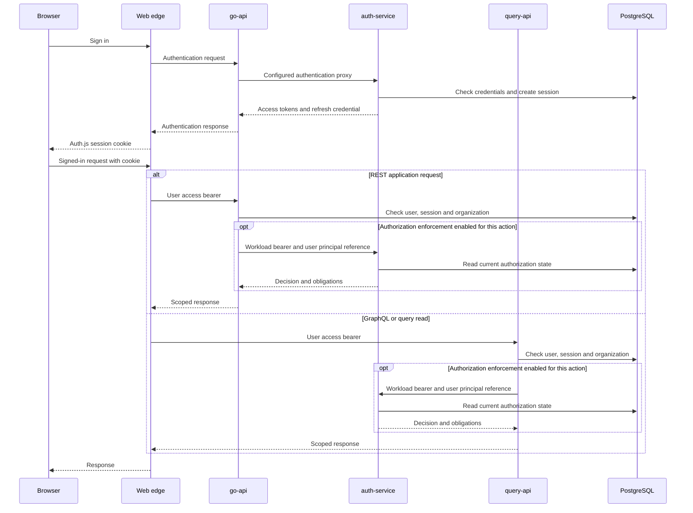

# Auth control plane

auth-service issues user access tokens and owns session and credential lifecycle operations.
go-api and query-api verify those tokens and check current database state.
Authentication establishes identity. Route guards and authorization decisions determine what that identity can do.

## Services and boundaries

| Service | Responsibility |
| --- | --- |
| auth-service | Sign-in, refresh, session revocation, credential exchange, internal provisioning, public discovery and signing keys, and the policy decision point. |
| go-api | REST application routes. It forwards configured authentication and provisioning operations to auth-service and enforces application access rules. It does not mint user access tokens. |
| query-api | GraphQL, query and REST read surfaces. It verifies accepted user bearers itself and checks user, session and organization state. |
| Go workers | River background jobs. They use domain, queue-control, provider and analytics credentials for their work. They do not issue browser sign-in tokens. |
| Web edge | Auth.js browser sessions and server-side calls to the backend. Its session secret is separate from backend token signing keys. |

auth-service has separate API, operator and optional internal listeners.
The operator listener serves health, readiness and metrics.
The internal listener exposes token exchange and authorization routes when configured.
Internal provisioning routes use workload authentication. They are not browser login endpoints.
See [service configuration](../../reference/auth/configuration.md) and
[endpoint profiles](../../reference/auth/endpoint-profiles.md) for the mounted routes and accepted classes.

## Signed-in request path

The web server unwraps its session and presents the backend access token.
The receiving API selects the verifier from the endpoint profile and token class.
It verifies the signature, issuer, audience, token type and expiry.
It then reads the user and session. The user must be active.
The session must belong to that user, remain unrevoked and pin the current user token version.
Organization access also requires the route's live membership and scope checks.
An organization header alone grants nothing.

The APIs obtain public verification keys from the configured issuer's JWKS.
They do not need its private signing key.
A failing required state read does not grant access.
See [access-token validation](../../reference/auth/access-token-claims.md) and
[JWKS and discovery](../../reference/auth/jwks-and-discovery.md).

## Credential types

| Credential | Issuer and verifier | Boundary |
| --- | --- | --- |
| User access token | auth-service signs an Ed25519 JWS with `alg=EdDSA` and `typ=at+jwt`. go-api and query-api verify `dev-health-api` tokens. auth-service session routes verify the separate `auth-service` audience. | Identity and session only. Roles and permissions are not claims. The default lifetime is 60 minutes, configurable from 5 to 60 whole minutes. |
| Refresh credential | auth-service issues and consumes the opaque `dhr1_` credential. | It is stored as a SHA-256 digest. It is not an API bearer. |
| Workload token | auth-service exchanges a registered workload subject for an EdDSA `workload+jwt` token. Internal services verify its issuer, audience and registered workload identity. | At most 300 seconds. It names no user session or organization. It cannot supply a user's organization authority. |
| Web workload assertion | The web server signs an Ed25519 assertion in `X-ACR-Web-Assertion`. Ask Dev verifies it with the web public keys and replay checks. | A separate signing key and verifier. The assertion lasts at most 30 seconds and its token id is single use. |
| Service-account key and token | auth-service issues an `fcsak_` key and, when `AUTH_SERVICE_ACCOUNT_EXCHANGE` is enabled, exchanges it for an EdDSA `sa+jwt` token. | The key is stored by digest and returned once. The token binds the organization and originating credential, lasts at most 300 seconds and cannot outlive that key. Public resource routes do not yet accept this bearer. |
| Former principal envelope | The former go-api edge issuer signs an EdDSA envelope with `typ=JWT`. | Retired. No query-api endpoint profile accepts it. It is not a hop in the signed-in request path. |

The HS256 user access-token class is retired too. No endpoint profile accepts it.
`JWT_SECRET_KEY` is not an access-token signing requirement.
The [generated credential reference](../../reference/auth/credential-reference.md) lists every class,
including stored compatibility credentials that no route accepts.

A workload exchange accepts either a projected Kubernetes ServiceAccount token or an enabled bootstrap credential.
Kubernetes authenticates the projected token through TokenReview for the exchange audience.
The registry binds that reviewed identity to a workload.
The bootstrap path resolves an `fcwlb_` credential by digest.
Both paths narrow the requested audience and actions to the registered values.
The issued token cannot outlive its subject credential.
See the [workload registry](../../reference/auth/workload-registry.md),
[Kubernetes federation](../runbooks/auth-workload-kubernetes-federation.md) and
[bootstrap credential procedure](../runbooks/auth-workload-bootstrap-credential.md).

## Sessions and live state

The Auth.js cookie wraps backend tokens. It does not replace the backend session record.
auth-service stores sessions and refresh-credential families in PostgreSQL.
Refresh credentials have a seven-day rolling lifetime and rotate on use.
A repeat within 30 seconds returns the same successor.
Reuse outside the allowed grace revokes the family.
The successor key lets the service reproduce the successor during that grace window.

Revoking a session invalidates its still-unexpired access tokens at the next session check.
A user token-version change also invalidates sessions pinned to the old version.
Organization switching creates a successor session and revokes the predecessor.
Delegated sessions record the effective subject and real actor separately. They have no refresh credential.
The decision point checks the actor's current authority as well as the delegated session.
See [delegated sessions](../../reference/auth/delegated-sessions.md).

The public user record remains authoritative for shared user state.
The auth schema holds credential and password state and copies of shared identity fields.
Organizations and memberships remain public-schema records with auth-schema copies.
With `AUTH_PROXY_ORG_PROVISIONING=true`, auth-service writes both membership copies in one transaction.
With that switch off, direct public-schema writes can leave the auth copy stale.
See [organization and membership authority](../../reference/auth/org-membership-authority.md) for reconciliation.

## Policy decisions and enforcement

The policy decision point (PDP) runs in auth-service.
`POST /v1/authorize` evaluates one request. `POST /v1/authorize:batch` evaluates up to 100.
`POST /v1/authorize:repositories` lists the repositories a principal may read in one organization.
The calling service authenticates with its own workload token for auth-service.
The request separately names the user principal reference, action and resource.
The PDP resolves current principal, session, organization, membership and grant state.
A workload's permission to call the PDP does not grant access to the requested resource.

An allow includes obligations such as tenant scope, repository scope, redaction and assurance requirements.
The resource service must carry them out. An unsupported obligation cannot become an allow.
High-risk decisions and delegated-session decisions require an audit write before a response is served.
See [decisions and obligations](../../reference/auth/obligations.md) and
[decision clients](../../reference/auth/decision-clients.md).

PDP enforcement is selected by action namespace for each service.
`GO_API_AUTHZ_ENFORCE`, `QUERY_API_AUTHZ_ENFORCE` and `QUERY_API_HEADERS_AUTHZ_ENFORCE` control distinct paths.
They are off by default. Existing route guards still operate when a namespace is off.
Shadow evaluation observes decisions without changing the response.
An enabled path that cannot obtain a required decision refuses the request.
In go-api, a missing decision client for an enabled namespace produces a 503.
Authentication, organization scope and supported obligations remain necessary alongside a PDP allow.
See [authentication and authorization](../../reference/auth/authn-authz.md) for route coverage and exceptions.

Organization roles are `viewer`, `member`, `admin` and `owner`.
Repository grants can narrow repository actions independently of organization membership.
An absent, expired or revoked grant is not interchangeable with an unrestricted grant.
See [organization roles](../../reference/auth/org-member-roles.md) and
[resource grants](../../reference/auth/resource-grants.md).

## Platform roles

`platform_admin` holds platform administration actions.
`platform_owner` is a marker and grants no action by itself.
Organization ownership does not confer a platform role. Only human user principals hold platform roles.

`AUTH_PLATFORM_ROLES_OWNED` selects the authority source.
When off, platform administration follows `public.users.is_superuser`.
When on, it follows current `auth.platform_role_assignments`.
go-api and query-api read that state with the user record. A token cannot preserve revoked platform authority.
The last active platform administrator cannot be revoked through the normal role operation.
See [platform administrator](../../reference/auth/platform-admin.md).

## Signing-key custody and rotation

Only auth-service holds its token-signing private keys.
`AUTH_SIGNING_KEY_FILE` names a PKCS#8 Ed25519 PEM file; direct `AUTH_SIGNING_KEY` values are refused.
Key files are regular files opened without following symbolic links.
They contain exactly one private-key PEM block, are at most 8 KiB and have no group or other permission bits.
The chart stages mounted keys into a memory-backed volume at mode `0400`.

A key set has exactly one active signing key. Each key has a distinct `kid`.
The JWKS publishes pending, active and retiring public keys.
It excludes retired and compromised keys.
Planned rotation publishes a pending key for at least five minutes before activation.
The previous key stays available for verification during the required overlap.
Changing the staged key set requires a rollout.

Verifier caches delay removal of an old public key.
During a JWKS outage, the default client can retain cached keys for up to 15 minutes after its last good refresh.
A compromise response therefore also revokes affected sessions.
Use the [custody guide](../configure/auth-signing-key-custody.md),
[planned rotation](../runbooks/auth-signing-key-planned-rotation.md) and
[emergency rotation](../runbooks/auth-signing-key-emergency-rotation-and-rollback.md).

## Database roles and grants

Database privileges are separate from application roles and token scopes.
The runtime login is not the migration login. Long-running services do not receive migration credentials.

| Identity | Privileges and boundary |
| --- | --- |
| Auth migration login | Creates and migrates the auth schema and applies explicit runtime and reader grants. It is used by one-shot operator work. |
| Auth runtime login | Has the declared table and column privileges required by auth-service. It has no schema DDL authority. Signing-key metadata, workload bindings and policy vocabulary are read only. |
| Application domain login | Reads and writes permitted semantic data. Auth-schema access uses explicit reader grants rather than ownership. |
| Session reader | Reads only the session columns needed to check subject, revocation and token-version pin. Platform-role reads are added when that authority is enabled. |
| River queue-control login | Operates River through its dedicated direct or session connection. It does not gain general semantic or auth-schema authority. |

The auth runtime can insert and read security audit events but cannot update or delete them.
Grant application revokes excess privileges before applying the declared manifest.
Cross-schema access is explicit and includes column-level grants.
Runtime posture checks detect role and privilege drift.
PostgreSQL permissions do not replace application authorization, and workload tokens do not replace database logins.
See [databases and storage](../configure/databases-and-storage.md) and
[production installation](../install/production.md).
