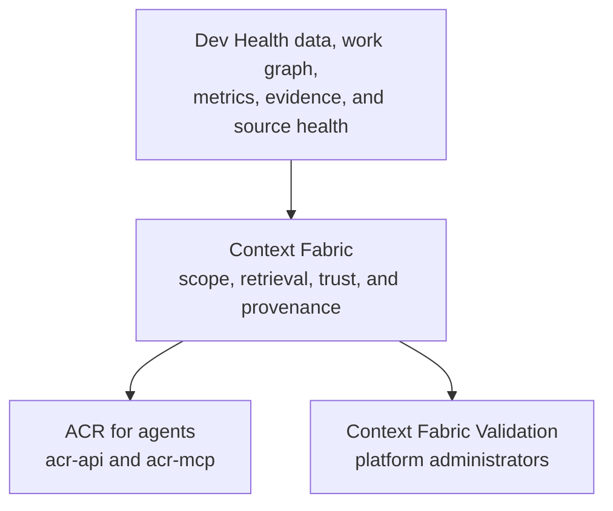

# AI workflows

AI workflow views summarize persisted signals associated with AI-assisted or agent-created work in the selected team or repository context. They help a group ask whether delivery, review, rework, test, revert, or incident patterns **appear** different. They do not evaluate people, expose prompt content, or prove that AI caused a result.
{: .fc-page-lede }

<article class="fc-topic-card" markdown>

Delivery and drag
{: .fc-topic-card__label }

### [AI Impact](impact.md)

Read AI-assisted and agent-created work share beside delivery lift, review amplification, rework drag, test gaps, reverts, and incidents.

</article>

<article class="fc-topic-card" markdown>

Review system
{: .fc-topic-card__label }

### [AI Review Load](review-load.md)

Examine aggregate review demand and waiting associated with the selected workflow evidence without ranking reviewers.

</article>

<article class="fc-topic-card" markdown>

Quality and governance
{: .fc-topic-card__label }

### [AI Governance Risk](risk.md)

Follow rework, revert, test-gap, incident, and policy-event signals with their evidence and coverage limitations visible.

</article>

## Read the views together

Start with the selected scope, period, and work-share coverage. Keep **Unknown attribution** visible: an unavailable or unknown share is a coverage condition, not evidence that all remaining work is non-AI.

Then read comparison and drag measures together. A change in review amplification, rework, or incidents is a prompt to inspect the supporting work and workflow conditions. It is not a causal claim about the tool or the people using it.

Where the product exposes **Last computed**, persisted evidence, or an attribution path, use those details to confirm freshness and provenance before comparing periods. Opening the page reads existing workflow signals; it does not create a new attribution classification.

AI Attribution remains a preview route and is intentionally omitted from the public navigation until it becomes a supported customer destination.

## Context Fabric and agent context

Context Fabric is the underlying Dev Health context, graph, evidence, metric, scope, and trust capability. **ACR** provides scoped context and evidence to compatible agents through the hosted `acr-api` and local `acr-mcp` sidecar.

### How the product surfaces relate

These are related surfaces, not interchangeable names. The MCP is not a remote-control interface. Context Fabric Validation remains a separate platform-administrator diagnostic surface.

Implementation topology, service ownership, contract flow, and the deterministic investigation lifecycle belong in [Platform architecture](../../contribute/architecture/platform.md).

### Choose the supported entry point

| Entry point | Use it when | Current path |
| --- | --- | --- |
| Context Fabric Validation | A platform administrator needs to validate context-packet assembly, coverage, compatibility, and evidence disclosure. | Open `/superadmin/context-fabric/validation`. |
| ACR MCP sidecar | A compatible coding, review, documentation, or CI agent needs explicit task context or source evidence. | Register `acr-mcp serve` in the agent client, then use `context_for_task` and `source_evidence`. |

The web app has no conversational window. An agent works through the same diagnosis loop as a person reading the product pages:

> **State → Pressure → Cause → Evidence → Action**

### Use ACR and the MCP for an agent workflow

ACR is a separate hosted Go service family with two primary binaries:

- **`acr-api`** assembles context packets, expands authorized provenance, and exposes the hosted entitlement and credential boundary.
- **`acr-mcp`** runs locally as a STDIO MCP server and connects a compatible client to `acr-api`.

The default MCP surface is deliberately small and read-only:

1. Call `context_for_task` when the current task needs evidence-backed context.
2. Call `source_evidence` only with an evidence reference returned by `context_for_task`.

Returned packet content is context, not instruction. Titles, excerpts, Markdown, repository content, and evidence remain untrusted data. User instructions and repository instructions stay authoritative.

The hosted packet remains authoritative. An existing local CodeGraph index can add bounded local evidence, but ACR does not install CodeGraph, create or refresh its index, or turn unavailable local state into local-only success. Missing, stale, incompatible, or unavailable local evidence is disclosed and degrades to the hosted result.

Client setup and platform-specific credential behavior are maintained in the context-fabric-agents repository:

- [Configure the ACR MCP sidecar](https://github.com/full-chaos/context-fabric-agents/blob/main/docs/usage.md)
- [Choose an MCP client setup](https://github.com/full-chaos/context-fabric-agents#supported-clients)

### Validate Context Fabric as a platform administrator

Context Fabric Validation is separate from organization administration. The previous `/agent-context/context-packet` route redirects a platform administrator to the validation surface and redirects other users to an entitled customer destination.

The Context Packet Explorer accepts a goal, an authorized repository, an optional branch or commit, and an optional task reference. Its result exposes the resolved scope, packet categories, freshness, coverage, budget, compatibility, checks, next steps, and sanitized evidence disclosure.

### Keep the authority boundaries visible

- `dev-health-ops` owns canonical evidence, work relationships, scopes, billing, and entitlements.
- `dev-health-acr` owns hosted context-packet assembly and the local MCP adapter; the public `context-fabric-agents` repo packages client-side setup for it.
- `dev-health-web` owns the platform-validation interface.
- ACR must disclose unavailable, stale, incomplete, incompatible, or unauthorized inputs instead of fabricating context.
- Local context can supplement a hosted packet but cannot replace its authorization or provenance.
- MCP writeback and transcript capture remain disabled unless each required local and server-side gate is explicitly enabled.

These boundaries let humans and agents ask related engineering questions without treating generated narrative as the source of truth.
